<div align="center">
  <h1>📺 webos-root</h1>
  <p><strong>Rooteé mi tele LG vieja y le cambié la interfaz desde adentro.<br>Sin publicidad, con el triple de memoria libre y una pantalla de inicio a mi gusto.</strong></p>
  
  <p>
    
    
    
    
    
    
    
  </p>
</div>

---

Tengo una **LG 50UM7360** del 2019 que uso para dos cosas: jugar a la Xbox y ver pelis. Con los años se puso insoportable: lenta, llena de publicidad, con "recomendados" que nunca pedí y abriendo apps sola en segundo plano.

Así que la rooteé y la dejé como yo quería. Lo hice junto con **Claude Code** y armé todo para que lo puedas repetir igual: seguís la guía, Claude hace la parte técnica y te va diciendo qué tocar.

Una regla que me puse desde el principio: **nada destructivo y todo reversible.**

## 🧩 Esto no es un launcher

Hay apps que te ponen un "launcher" arriba de la tele: una app web que se abre encima de la interfaz de LG y la maquilla. Por abajo la tele sigue igual, con su publicidad, sus apps precargadas y la memoria al límite, y encima le sumás una app más corriendo.

Acá es al revés: **cambio la interfaz del propio sistema de LG.** La pantalla de inicio (`com.webos.app.fullhome`), el protector de pantalla y la pantalla de las entradas son las de LG, modificadas desde adentro. Es el mismo QML que usa LG, con nuestras piezas montadas encima de las originales. No se instala nada extra, y como no se borra nada, se puede volver a la original cuando quieras.

Y no es solo lo que se ve:

- 🚫 **Publicidad afuera.** Bloqueo los servidores de anuncios y seguimiento de LG. Hasta encontré que la pantalla de inicio reproducía **videos de publicidad escondidos**, aunque no se vieran.
- 🧠 **Memoria.** Las apps ya no se abren solas, y un vigilante cierra las que quedan abiertas atrás: cuando cambiás de app, cuando pasás a la consola o cuando dejás el inicio a la vista un minuto. Ocupa 4 MB (junto con los botones del control).
- 🔌 **Servicios que no usás**, apagados. AirPlay, compartir pantalla y el audio Bluetooth son opcionales: la instalación te pregunta.
- 🔐 **Que sobreviva a todo.** Un acceso propio de administrador que no depende del modo desarrollador de LG. Lo probé desenchufando la tele: en un minuto y medio vuelve todo solo.

## 📊 Resultados en mi tele

| | Antes | Después |
|---|---|---|
| Memoria libre | 138 MB | **426 MB** recién prendida · ~300 MB en uso |
| Procesador ocupado con la tele quieta (protector de fotos andando) | 69 % | **~11 %** |
| Pantalla de inicio | 126 MB (la de LG, y sigue subiendo con la publicidad) | **91 MB** con todo lo nuestro |
| Protector de fotos | — | **+15 MB** mientras se ve, y los devuelve al cerrarse |
| Apps abiertas sin usarlas | Netflix, YouTube, Asistente, Guía, AirPlay | **ninguna** |
| Publicidad en la pantalla de inicio | sí (hasta videos ocultos) | **no** |
| Botón HOME | — | el inicio aparece en **0,5–1 s** |
| Después de un corte de luz | — | **queda todo igual** |

Cómo se midió cada cosa: [AUDITORIA.md](AUDITORIA.md) y [SCREENSAVER.md](SCREENSAVER.md).

Y de yapa:

- 🏠 **Pantalla de inicio a mi gusto**: reloj, clima, dólar y Bitcoin, el calendario de la familia, mis últimas apps, la lista completa de apps y un panel de entradas. Todo con el control remoto.
- 🖼️ **Protector de pantalla con fotos** de un álbum compartido de Google Photos, de a una al azar y sin guardarlas en la tele. Recorre el álbum **entero** (aunque tenga miles de fotos): cada hora toma 300 que todavía no salieron.
- ⚙️ **Configuración propia** desde el engranaje de arriba, con el mismo estilo que el panel de entradas, y un acceso a los ajustes de LG.
- 🧩 **Widgets a tu gusto**: en Configuración → Widgets elegís qué widgets van en el inicio (clima, mercados, calendario… y los que se sumen), dónde y de qué tamaño, en una cuadrícula de 4 × 4.
- 🎨 **Tema**: fondo con los colores de la app elegida, un color fijo o **tu propia foto**; color de los paneles, color de lo seleccionado y tamaño de letra.
- 🖼️ **Protector editable sobre la pantalla misma**: elegís qué va en cada parte (hora, fecha, clima, eventos del calendario, fecha de la foto… o nada) y de qué tamaño.
- 🎮 **Botones del control con otra función**: en Configuración → Control remoto elegís qué hace NETFLIX, Prime Video, los cuatro colores, MOVIES, ▶ y ⏸ (abrir una app, ir a una entrada, abrir una página, apagar solo la pantalla, temporizador, volumen fijo…). O desde el listado de apps: mantené OK → **Asignar a un botón** y tocá el botón. Detalle en [BOTONES.md](BOTONES.md).
- 📶 **Wi-Fi que se acuerda de tus redes**: lista de redes que se actualiza sola, conexión sin volver a escribir la contraseña y, si se corta el wifi, **se reconecta solo** a la última red (o a la siguiente guardada que esté al alcance). Las contraseñas quedan solo en la tele, nunca en el repo. **Es opcional:** si no querés que tus claves queden guardadas en la tele, decíselo a Claude y no se activa.

> ✅ **Todo es opcional.** Al instalar, Claude te pregunta qué querés activar y qué no (fotos, calendario, Wi-Fi que guarda claves, AirPlay, Bluetooth). Si después cambiás de idea, pedíselo y lo prende o lo apaga.

## 📸 Capturas

Sacadas de la tele con `tools/tvshot.sh` y el modo demostración (`tools/modo-demo.sh`: calendario inventado y fotos libres de [picsum.photos](https://picsum.photos)). Los nombres de redes y el enlace del álbum están tapados.

| Pantalla de inicio | Listado de apps |
|---|---|
| 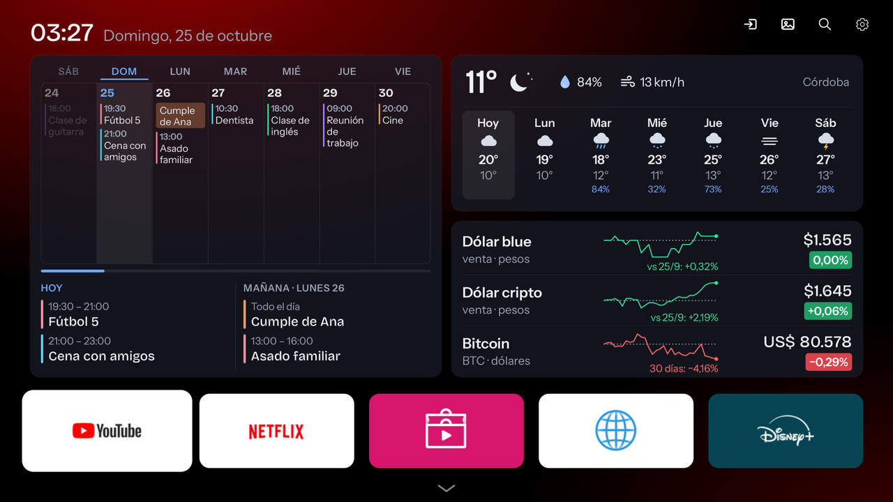 | 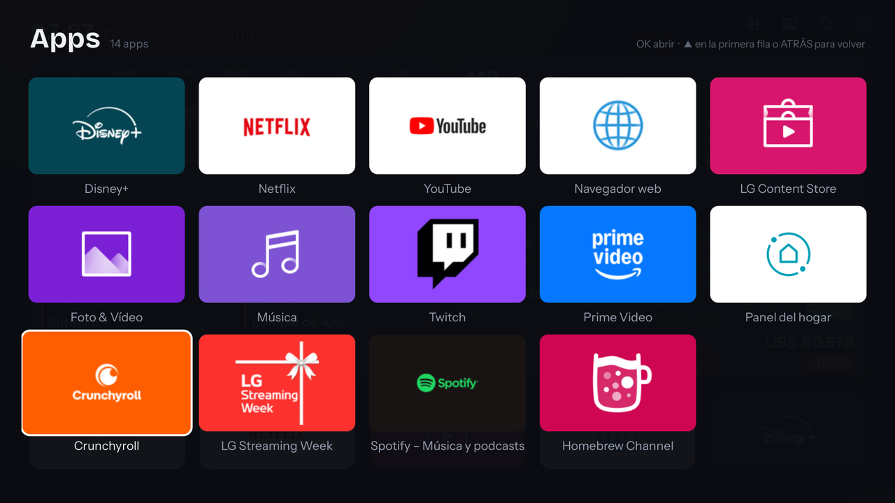 |
| **Configuración** | **Control remoto** |
| 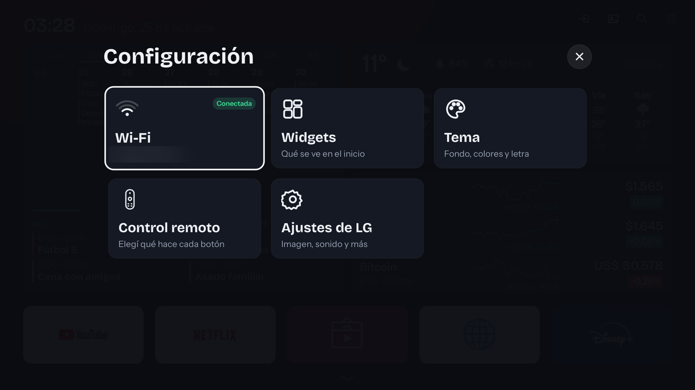 | 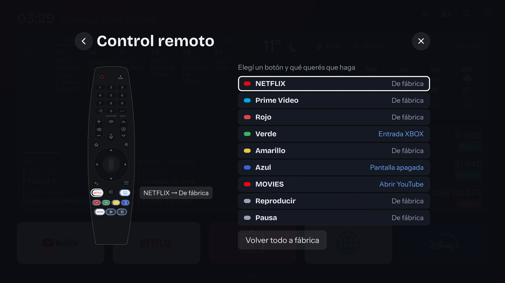 |
| **Qué hace cada botón** | **Asignar una app a un botón** |
| 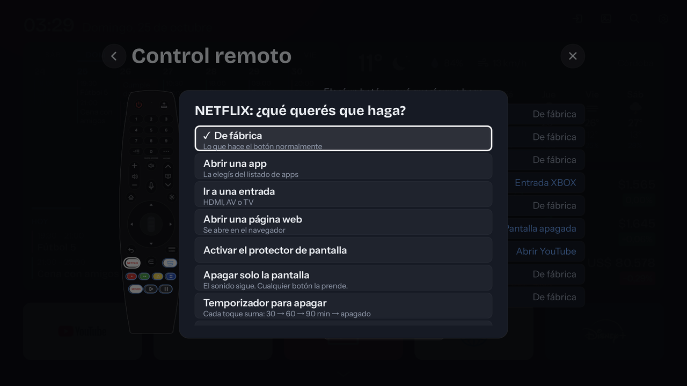 | 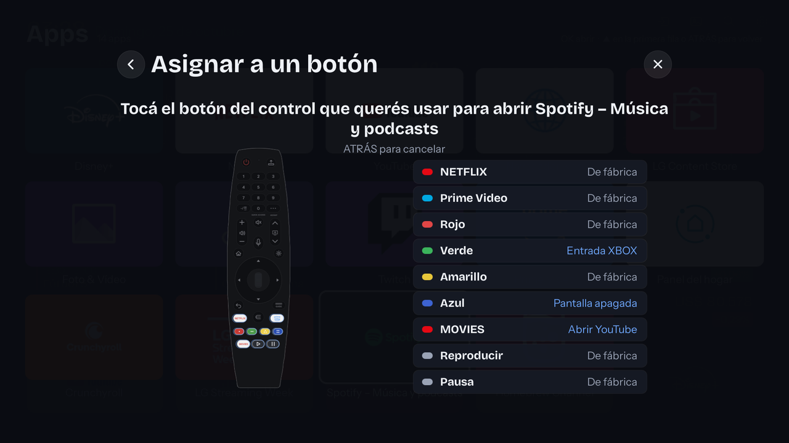 |
| **Widgets** | **Tema** |
| 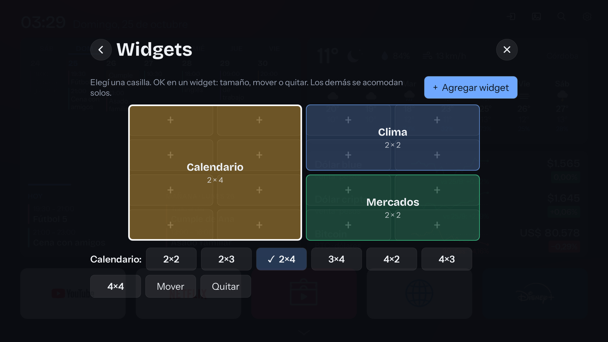 | 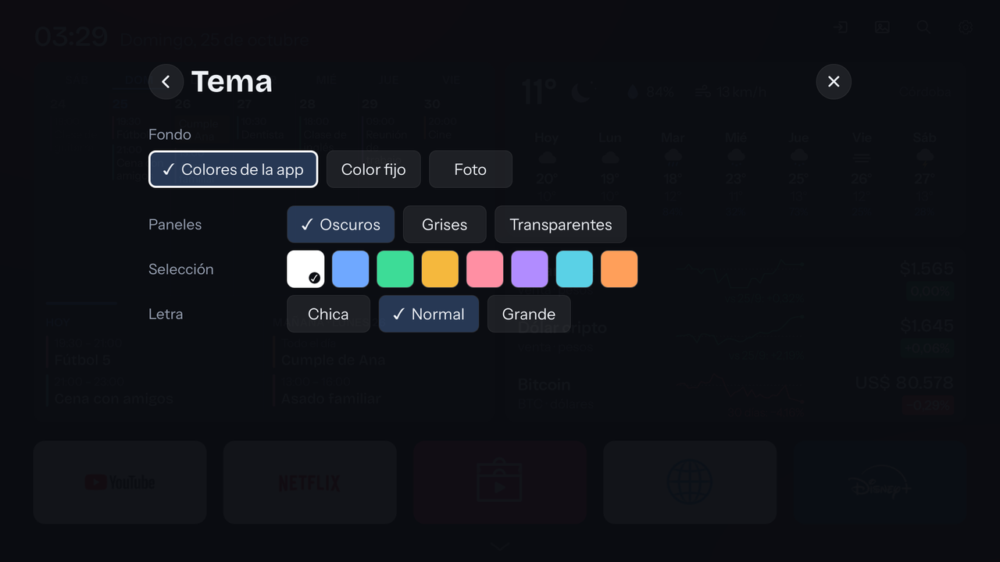 |
| **Entradas** | **Clima por hora** |
| 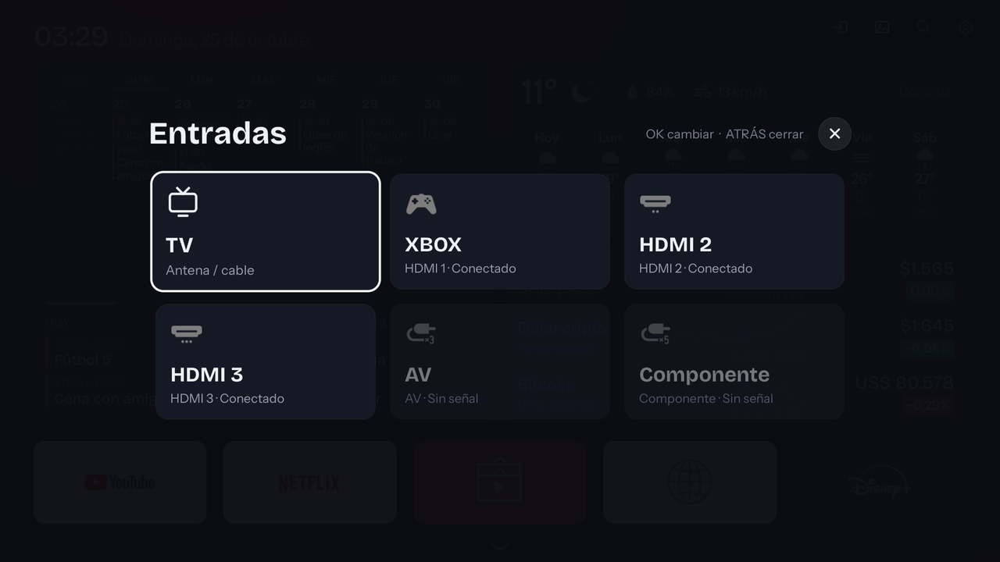 | 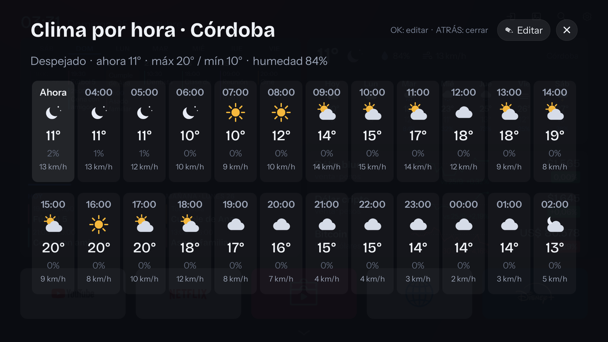 |
| **Protector de fotos** | **Protector editable** |
| 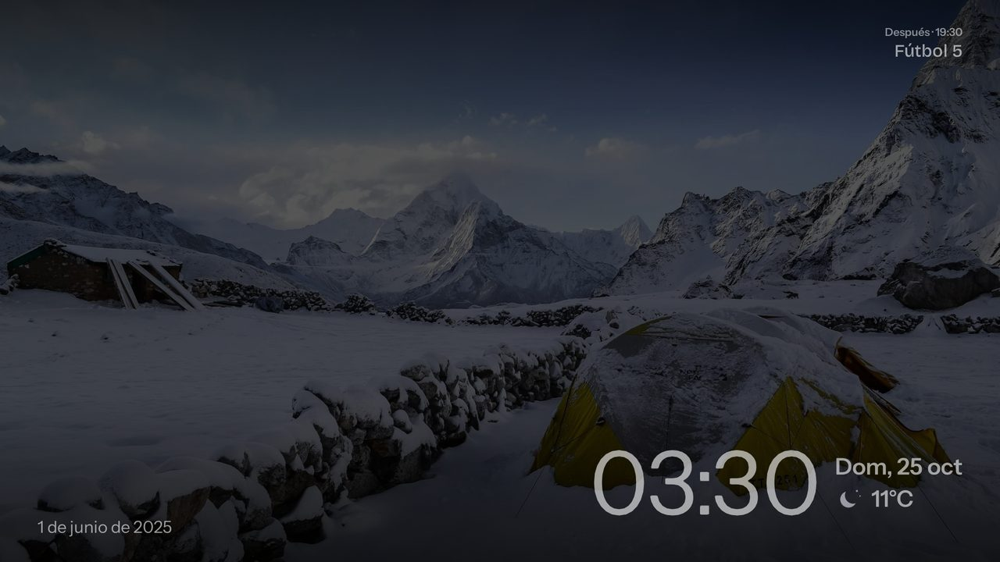 | 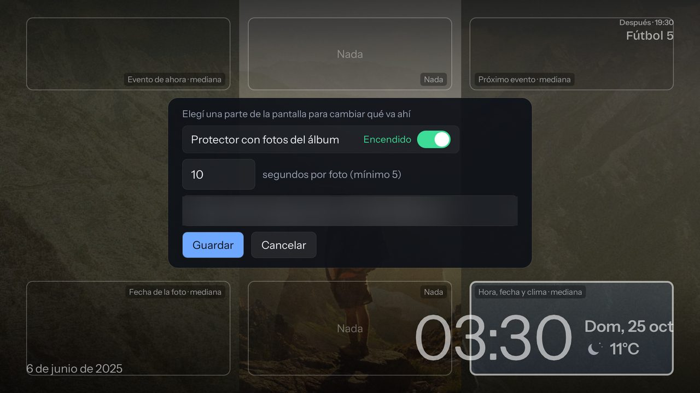 |
| **Wi-Fi** | **Menú de una app** |
| 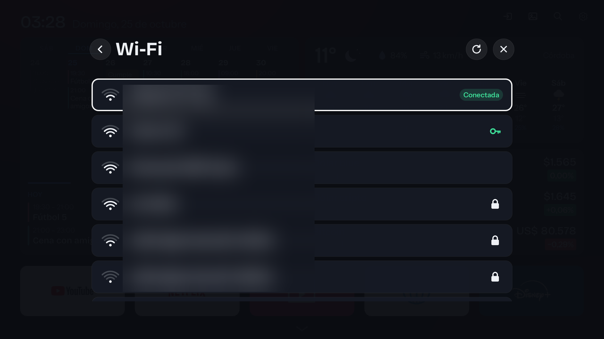 | 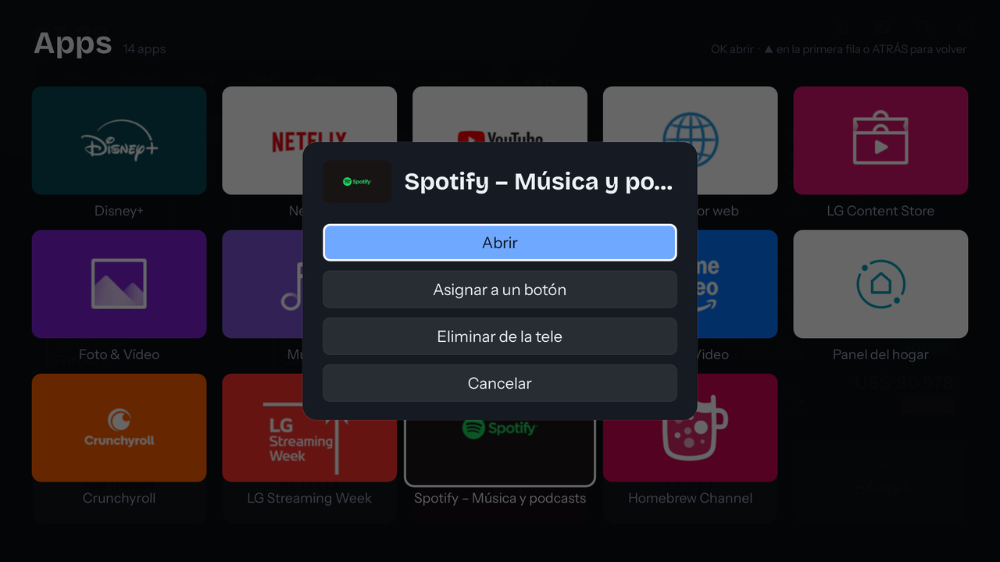 |

## 🚀 Cómo hacerlo en tu tele

> 🙋 **No hace falta saber programar.** La guía es paso a paso y está pensada para cualquiera: si sabés instalar una app, alcanza. Lo técnico lo hace Claude.

### 1 · Instalá Claude

Bajá la app de escritorio desde [claude.ai/download](https://claude.ai/download) y abrí la pestaña **Code** (o usá [Claude Code](https://docs.claude.com/claude-code) en la terminal). Necesitás un plan que incluya Claude Code.

### 2 · Bajá el repo (o pedíselo a Claude)

La forma más fácil: en Claude Code escribile *"bajá el repositorio https://github.com/fjanuszewski/webos-root y abrilo"*, y listo.

También podés bajarlo como ZIP desde el botón verde **Code → Download ZIP**, o con git:

```bash
git clone https://github.com/fjanuszewski/webos-root.git
```

### 3 · Escribí `/rootear`

Claude lee [CLAUDE.md](CLAUDE.md) y te va guiando de a un paso. Además tenés estos comandos:

| Comando | Qué hace |
|---|---|
| `/rootear` | Te guía por todo, desde cero |
| `/conectar` | Arregla la conexión entre la compu y la tele |
| `/instalar` | Instala (o reinstala) todo en la tele |
| `/estado` | Te dice cómo está la tele, sin tocar nada |
| `/deshacer` | Vuelve atrás lo que elijas |
| `/sumar-mi-tele` | Suma tu tele a la tabla de compatibles |

O directamente preguntale con tus palabras: *"no me conecta la tele"*, *"¿por qué está lenta?"*, *"quiero cambiar las fotos del protector"*.

### 4 · La guía completa

Está en **[GUIA-ROOT.md](GUIA-ROOT.md)**, para leer a la par. En corto:

1. Cuenta de LG, que es la misma de desarrollador, y aceptás los términos.
2. App **Developer Mode** en la tele.
3. **Dev Manager** en la compu. Claude te pasa los datos para conectarte.
4. Un comando en la terminal de Dev Manager y la tele queda rooteada.
5. Claude deja la **puerta trasera** para que nada se pierda, y lo probás desenchufando la tele.
6. Claude **instala todo** y te pregunta qué querés apagar.

> 💡 **¿Tu router no deja que la compu y la tele se vean?** Me pasó. La guía explica cómo usar un **celular Android de puente**.

### ↩️ Volver atrás

`./restore-services.sh` reactiva los servicios, `./adblock.sh off` saca el bloqueo de publicidad y cada parte tiene su propia llave de apagado. Detalle en la guía.

## 📺 Teles compatibles

Lo probé en una sola tele, la mía. La idea es que esta tabla la vayamos llenando entre todos: **si lo probás en la tuya, sumala**, salga bien o mal. Te explico cómo en [CONTRIBUTING.md](CONTRIBUTING.md).

| Modelo | Año | webOS | Firmware | Root | Pantalla de inicio | Protector | Optimización | Probado por |
|---|---|---|---|---|---|---|---|---|
| LG 50UM7360 | 2019 | 4.10.2 (4.5) | 05.40.97 | ✅ | ✅ | ✅ | ✅ | [@fjanuszewski](https://github.com/fjanuszewski) |
| *¿la tuya?* | | | | | | | | |

✅ anda · ⚠️ anda con cambios (contalo en la nota) · ❌ no anda · ➖ no probado

## 🗂️ Qué hay en el repo

| | |
|---|---|
| [GUIA-ROOT.md](GUIA-ROOT.md) | La guía paso a paso. **Empezá por acá** |
| [CLAUDE.md](CLAUDE.md) | Instrucciones para el Claude que te guía |
| `init.d-50-cytv-debloat.sh` | Lo que corre solo cada vez que se prende la tele |
| `cleanhome/` | La pantalla de inicio y el protector de fotos (QML) |
| `patches/` | Los cambios a los archivos de LG, como parches. Los originales no están acá: se bajan de tu propia tele |
| `botones/` | Los botones del control con otra función y el vigilante que cierra las apps abiertas (Python, ~4 MB) |
| `hosts.block` | Lista de bloqueo de publicidad y seguimiento |
| `tools/` | Scripts para instalar todo, subir cambios y medir la tele |
| `design/launcher.html` | Vista previa de la pantalla de inicio, para abrir en el navegador |
| `docs/img/` | Capturas y la animación de este README |

<details>
<summary><strong>📚 Documentación técnica</strong></summary>

| | |
|---|---|
| [PERSISTENCIA.md](PERSISTENCIA.md) | Cómo sobrevive a los reinicios y a los cortes de luz |
| [DEBLOAT.md](DEBLOAT.md) | Qué se apaga, por qué y cuánto ahorra |
| [AUDITORIA.md](AUDITORIA.md) | La medición de antes y después, proceso por proceso |
| [HOME-MOD.md](HOME-MOD.md) | Cómo está hecha la pantalla de inicio |
| [SCREENSAVER.md](SCREENSAVER.md) | Cómo funciona el protector de fotos (y cuánta memoria y procesador usa) |
| [BOTONES.md](BOTONES.md) | Los botones del control con otra función |
| [COMANDOS.md](COMANDOS.md) | Comandos para el día a día |

</details>

## 🤝 Contribuir

Contribuciones bienvenidas: probarlo en tu tele, arreglar algo, mejorar la guía o sumar un panel nuevo a la pantalla de inicio. Mirá [CONTRIBUTING.md](CONTRIBUTING.md).

## 🙌 Gracias

- [faultmanager-autoroot](https://github.com/throwaway96/faultmanager-autoroot), de throwaway96, por el root.
- [webOS Homebrew](https://www.webosbrew.org/), por el [Homebrew Channel](https://github.com/webosbrew/webos-homebrew-channel) y el [Dev Manager](https://github.com/webosbrew/dev-manager-desktop).
- Tipografías Bricolage Grotesque e Instrument Sans (licencia OFL, en `cleanhome/fonts/LICENCIAS.md`).
- Datos de [open-meteo](https://open-meteo.com/), [DolarApi](https://dolarapi.com/), [ArgentinaDatos](https://argentinadatos.com/) y [CoinGecko](https://www.coingecko.com/).

## 👋 Sobre mí

Soy **Fabian Januszewski**, de Argentina. Trabajo con AWS y serverless, y me gusta desarmar cosas para ver cómo funcionan. Esta tele fue la excusa.

[](https://github.com/fjanuszewski)

---

<sub>⚠️ Rootear la tele corre por tu cuenta y puede afectar la garantía. Este proyecto no tiene nada que ver con LG; webOS y LG son marcas de LG Electronics. Licencia [MIT](LICENSE).</sub>
